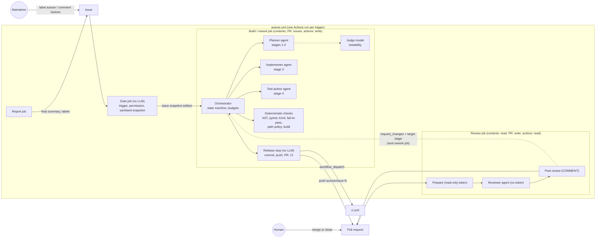

# Component view

What the implementation consists of and how the parts call each other. The code is in the fork under `.github/` (copy in `workflow/`).

## Agents, tools and permissions

| Component | Model (default) | Tools | May write | GitHub token |
|---|---|---|---|---|
| Gate | none | GitHub REST | status comment, labels | job token, step env |
| Planner (stages 1-2) | gemini-3.5-flash-lite | list_files, read_file, search_code, run_command, read_skill_file / read_artifact, submit_spec, cannot_specify, submit_design, cannot_design | nothing (work tree reset after each session) | none |
| Judge | gemini-3.1-flash-lite | none | nothing | none |
| Implementer (stage 3) | gemini-3.5-flash-lite | read tools, write_file, edit_file, run_command, read_artifact, finish_implementation, request_redesign, dispute_test | `tinydb/**`, `docs/**`, `README.rst` | none |
| Test author (stage 4) | gemini-3.1-flash-lite | read tools, write_file, edit_file, run_command, read_artifact, submit_tests | only `tests/test_issue_<N>.py` | none |
| Orchestrator + checks + release | none | git, pytest, GitHub REST | commits on `autose/*` branches, PR, CI dispatch | in memory, from a deleted file |
| Reviewer (stage 6) | gemini-3.1-flash-lite | read tools, run_command, write_file/edit_file (scratch only), get_diff, submit_review | `scratch/` outside the repo | none (job token is read-only) |
| Report | none | GitHub REST | status comment, labels | job token |

Enforcement points (code): `autose/tools.py` (path policy), `autose/sandbox.py` (scrubbed environment, deny rules, timeouts), `autose/stages/__init__.py::enforce` (reverts out-of-policy changes made by any means), `autose/secretstore.py` (credentials from files that are deleted before agents start), job-level `permissions:` in the workflow files.
