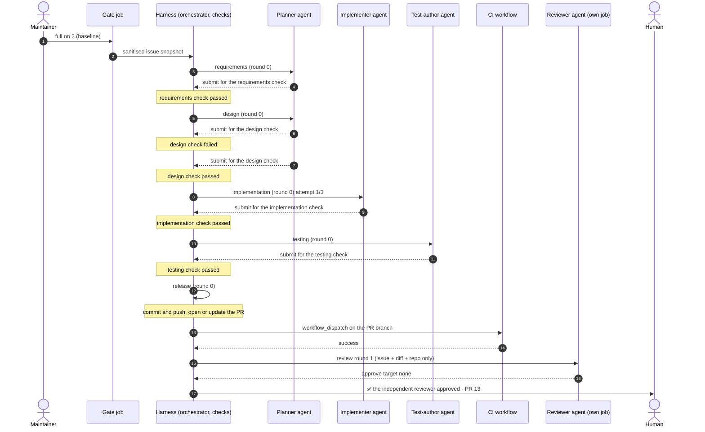

# Sequence view (one real run)

This view comes from a real baseline run on issue #2 (issue_1), chosen for demonstration.

Run: [44724438807](https://github.com/Ishaank1805/tinydb/actions/runs/44724438807)

