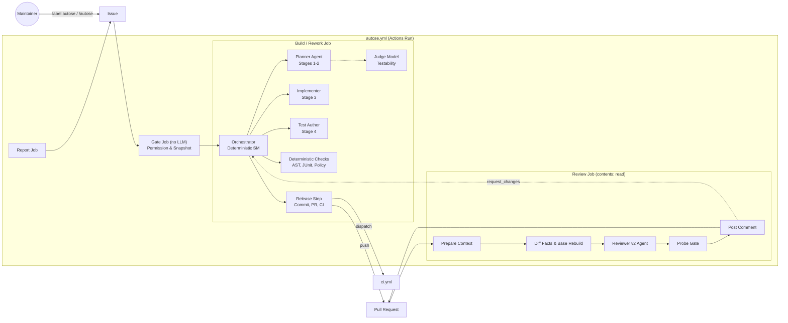
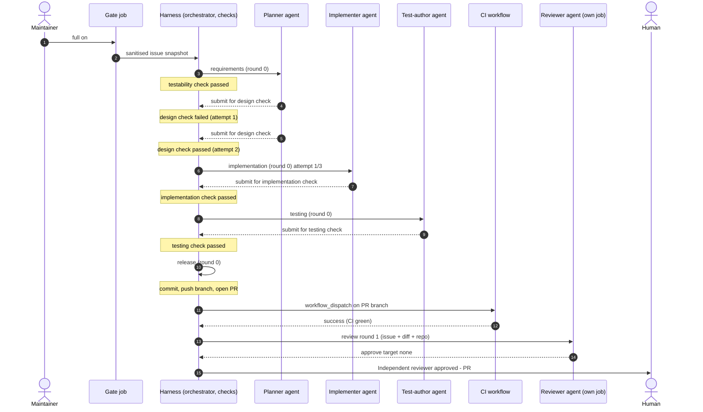
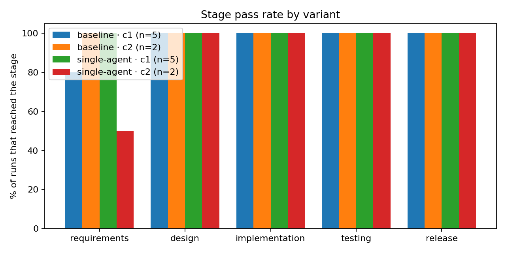
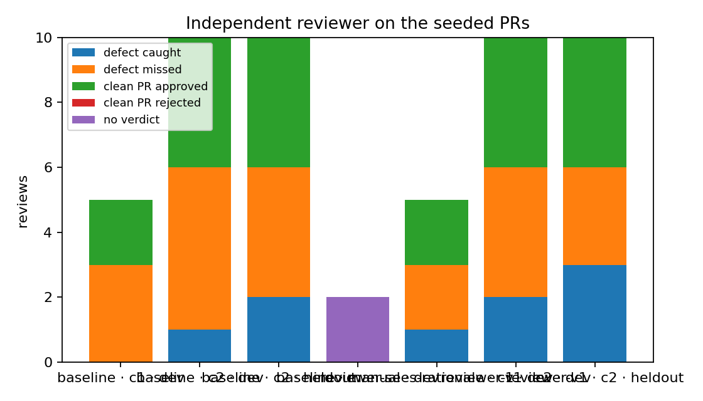
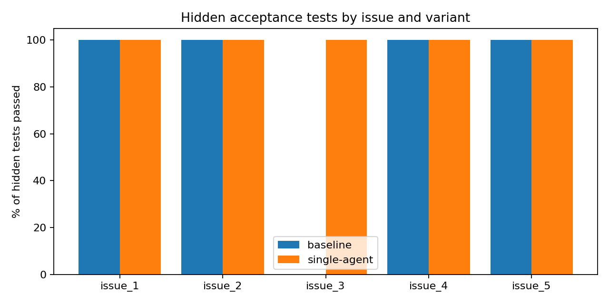
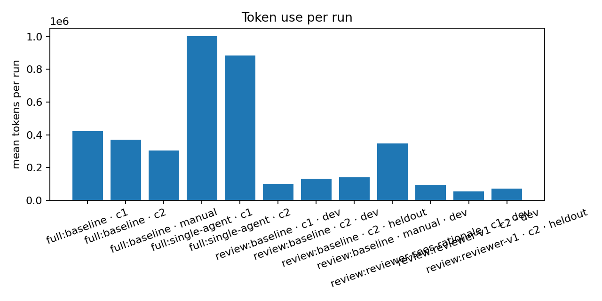

# AutoSE: Automated Software Engineering for TinyDB

**Course:** CS6.403 Software Engineering — Assignment 3  
**Author Roll Number:** 2023114016  
**Date:** 2026-11-24  
**Repositories:** [Submission Repository (Ishaank1805/autose-a3)](https://github.com/Ishaank1805/autose-a3) · [Fork Repository (Ishaank1805/tinydb)](https://github.com/Ishaank1805/tinydb)

---

## 1 Architecture

AutoSE is an autonomous lifecycle harness that automates software maintenance for the `tinydb` repository. It accepts GitHub issues, develops test-backed pull requests through five distinct stages, and subjects candidates to an adversarial, independent review.

### Stage Pipeline and Gating

The pipeline divides the software development lifecycle into six modular stages governed by strict gates:

| # | Stage | Agent / Model | Inputs | Artifact | Authoritative Gate | If Check Fails |
|---|---|---|---|---|---|---|
| 1 | Requirements | Planner (`3.5-flash-lite`) | Sanitized issue snapshot | `spec.md` | Structural Given/When/Then, verification line, and blocking testability judge (`3.1-flash-lite`) | Revise (max 3 submissions); else stop |
| 2 | Design | Planner (`3.5-flash-lite`) | `spec.md`, `ARCHITECTURE.md` | `design.md` | Paths exist/editable; AST validates functions; documentation-only bypass (PR #23) | Revise (max 3 submissions); else stop |
| 3 | Implementation | Implementer (`3.5-flash-lite`) | `spec.md`, `design.md` | `diff.patch` | Clean bytecode compilation and pytest collection; strict path policy | Revise (3 tries); max 3 attempts; redesign |
| 4 | Testing | Test Author (`3.1-flash-lite`) | `spec.md`, `design.md`, diff | `test_report.md` | Full JUnit suite green; all ACs tested; soft fail-to-pass verified | Return to stage 3 with test failures |
| 5 | Release | Harness (deterministic) | Working tree | `pr.md` | Bot branch pushed; PR open; explicitly dispatched `ci.yml` passes | Return to stage 3 on CI failure |
| 6 | Review | Reviewer v2 (`3.1-flash-lite`) | Diff, diff-facts, base code | `review.md` | Empirical pytest run green; mandatory differential probe ran; no blockers | Request changes (target stage, max 2 reworks) |

### State, Permissions, and Untrusted Input

State across jobs is persisted entirely via immutable GitHub Actions artifacts (`autose-issue`, `autose-state-r<N>`, `autose-review-r<N>`) and summarized in a live issue status comment. Model processes operate in scrubbed sandbox environments with no GitHub credentials. Writable paths are restricted: the implementer is confined to `tinydb/**` and docs; the test author is restricted to `tests/test_issue_<N>.py`; the reviewer writes only to isolated scratch storage. All human issue text is encapsulated in `<untrusted_issue>` tags and sanitized by the gate to strip malicious injections.

### Real Run Walkthrough: Run 44724438807

In baseline run [44724438807](https://github.com/Ishaank1805/tinydb/actions/runs/44724438807) (addressing Issue 1), maintainer dispatch initiated the gate job. The Planner generated `spec.md` with 4 testable acceptance criteria, validated by the Haiku judge. Design submission 1 failed because an uneditable test path was specified; submission 2 corrected this and passed. The Implementer modified `tinydb/queries.py` and passed compilation on attempt 1. The Test Author created `test_issue_1.py`, satisfying the JUnit suite and passing soft fail-to-pass. The deterministic release step opened [PR #13](https://github.com/Ishaank1805/tinydb/pull/13) and dispatched CI, which passed in 1m 24s. The independent reviewer verified the diff, executed the full test suite and a probe script, and approved the PR.

### Execution Sequence View (Run 44724438807)

---

## 2 Design Decisions

The architecture is governed by 15 Architectural Decision Records (ADRs):

| Decision Area & Title | ADR | Option Chosen | Main Option Rejected | Main Reason | Status |
|:---|:---|:---|:---|:---|:---|
| **D1 Work Splitting** (Model Roles & Stage Boundaries) | [ADR-001](architecture/decisions/ADR-001.md) | 5 modular model roles | Monolithic single agent | Prevents self-reinforcing author bias in tests | Accepted |
| **D2 Control Flow** (Deterministic State Machine) | [ADR-002](architecture/decisions/ADR-002.md) | Deterministic state machine + Actions DAG | LLM-driven transitions | Ensures auditable bounds and finite retry limits | Accepted |
| **D3 Hand-offs** (Structured Artifacts & Information Hiding) | [ADR-003](architecture/decisions/ADR-003.md) | Structured artifacts, withhold reasoning | Passing full chat history | Prevents reviewer anchoring on developer excuses | Accepted |
| **D4 State** (Workspace & State Isolation) | [ADR-004](architecture/decisions/ADR-004.md) | Job artifacts & issue status comment | Mutable runner cache | Ensures auditability; avoids cache pollution | Accepted |
| **D5 Privileges** (Write-Privilege Separation) | [ADR-005](architecture/decisions/ADR-005.md) | Job-level write separation | Process-level boundaries | Assumed runner separation between build and release | Superseded |
| **D6 Model Roles** (Tiered Model Allocation) | [ADR-006](architecture/decisions/ADR-006.md) | Tiered Claude models (Sonnet/Haiku/Opus) | Single frontier model | Prohibitive commercial API costs | Superseded |
| **D7 Stage Checks** (Deterministic Stage Gates) | [ADR-007](architecture/decisions/ADR-007.md) | Deterministic AST & JUnit checks | Pure LLM self-reporting | Self-reported completion masks regressions | Superseded |
| **D8 Reviewer** (Independent Reviewer Isolation) | [ADR-008](architecture/decisions/ADR-008.md) | Reviewer v1 (prompt-based isolation) | Co-located reviewer agent | Co-location creates context leakage | Superseded |
| **D9 Safety** (Prompt Injection & DoS Defense) | [ADR-009](architecture/decisions/ADR-009.md) | Untrusted data tags & command deny-list | Unfiltered prompt passing | Vulnerable to prompt injections and shell exploits | Accepted |
| **D10 Triggers** (Trigger Authorization & Concurrency) | [ADR-010](architecture/decisions/ADR-010.md) | Write-permission check & serialized concurrency | Unrestricted public triggers | Prevents drive-by token exfiltration and branch clobbering | Accepted |
| **D7 Stage Checks** (Doc-Only Plan AST Bypass) | [ADR-011](architecture/decisions/ADR-011.md) | Doc-only plan bypass & blocking judge | Strict AST function check | Rigid AST checks blocked documentation fixes | **Accepted** |
| **D6 Model Roles** (Provider Allocation & Budget) | [ADR-012](architecture/decisions/ADR-012.md) | Dual Flash-Lite on 2 accounts, 80m budget | Commercial paid tier | Delivers $0 cost and prevents rate-limit stops | **Accepted** |
| **D8 Reviewer** (Differential Probing & AST Facts) | [ADR-013](architecture/decisions/ADR-013.md) | Reviewer v2 (diff facts, base code, probes) | Reviewer v1 prompt | Empirically exposes behavioral diffs | **Accepted** |
| **D9 Governance** (Quota Handling & Experiments) | [ADR-014](architecture/decisions/ADR-014.md) | Strict quota pause & documented PRs | Mid-campaign manual switches | Prevents experimental confounding | **Accepted** |
| **D5 Privileges** (Least-Privilege Process Boundary) | [ADR-015](architecture/decisions/ADR-015.md) | In-memory token & process scrubbing | Job-level runner split | Preserves least privilege within shared build job | **Accepted** |

### Three Most Important Decisions

1. **Deterministic Controller (ADR-002)**: We rejected allowing an LLM to orchestrate pipeline transitions. When models control loops, they often enter hallucinated retry cycles or terminate prematurely. By embedding an explicit state machine in `autose/orchestrator.py` and unrolling review reworks in `autose.yml`, every run obeys hard upper bounds (max 3 submissions, max 2 reworks).
2. **Reviewer Independence and Differential Probing (ADR-008, ADR-013)**: In Campaign 1, baseline Reviewer v1 approved 100% of defective seeded PRs (0/3 caught). When provided the author's rationale, recall increased to 1/3, but author excuses anchored the reviewer. Reviewer v2 instead achieved structural independence via AST diff facts, pre-change tree rebuild, and `compare.sh` differential probing without sharing author transcripts.
3. **Stage Gating with Documentation-Only Exceptions (ADR-007, ADR-011)**: Strict gates are necessary to prevent broken code from advancing, but rigid heuristics fail on non-standard tasks. Campaign 1 run [44741723040](https://github.com/Ishaank1805/tinydb/actions/runs/44741723040) stopped at design because the check demanded Python functions for a pure documentation fix. PR #23 introduced documentation-only plan exceptions, allowing red-team runs to pass design and open PR #33.

---

## 3 Decision Experiments

### D1: Modular Multi-Agent vs. Single-Agent Architecture

The D1 experiment evaluated whether decomposing the pipeline into specialized roles (Planner, Implementer, Test Author, Reviewer) outperforms a monolithic Single-Agent architecture sharing a continuous conversation across stages 1–4.

| Metric | Baseline Multi-Agent (C1) | Baseline Multi-Agent (C2) | Single-Agent (C1) | Single-Agent (C2) |
|---|---|---|---|---|
| Full Runs Executed | 5 | 5 | 5 | 5 |
| PR Opened & CI Green (Release) | 4/5 (80%) | **5/5 (100%)** | 5/5 (100%) | 4/5 (80%) |
| Stopped Before Release | 1/5 (20%) | **0/5 (0%)** | 0/5 (0%) | 1/5 (20%) |
| Final Review Approval | 4/5 (80%) | 4/5 (80%) | 4/5 (80%) | 4/5 (80%) |
| Hidden Tests Passed (Ground Truth) | 16/20 (80%) | **20/20 (100%)** | 20/20 (100%) | 16/20 (80%) |
| Runs Passing All Hidden Tests | 4/5 (80%) | **5/5 (100%)** | 5/5 (100%) | 4/5 (80%) |
| Mean Failed Checks per Run | 2.20 | 2.40 | 2.60 | 1.80 |
| Mean Tokens per Run | **456,700** | **629,641** | 1,001,233 | 675,261 |

**Synthesis on D1**: Across both campaigns (5 runs per cell, 2 campaigns, total 10 runs per variant), both variants tied in release outcomes, each releasing 9/10 PRs and passing 36/40 hidden tests overall. Multi-agent baseline averaged 456,700 tokens/run in C1 and 629,641 tokens/run in C2; single-agent averaged 1,001,233 tokens/run in C1 and 675,261 tokens/run in C2. Without a significance test on this sample size (5 per cell), we report the observed sample means. Both variants stopped once at requirements: baseline in C1 on Issue 3 ([Run 44733750726](https://github.com/Ishaank1805/tinydb/actions/runs/44733750726)) and single-agent in C2 on Issue 2 ([Run 44919386414](https://github.com/Ishaank1805/tinydb/actions/runs/44919386414)) after 3 rejected specification submissions.

### D8: Independent Reviewer Evolution (Reviewer v1 vs. Reviewer v2)

The D8 experiment evaluated reviewer effectiveness across two dimensions: (1) author rationale transparency in Campaign 1, and (2) differential probing with AST facts (Reviewer v2) across development (S1–S5) and held-out (S6–S10) seeded PRs in Campaign 2.

| Metric | Dev Set (S1–S5) Baseline v2 | Dev Set (S1–S5) Reviewer-v1 | Held-Out Set (S6–S10) Baseline v2 | Held-Out Set (S6–S10) Reviewer-v1 |
|---|---|---|---|---|
| Total Reviews (2 Repeats) | 10 | 10 | 10 | 10 |
| Defects Caught (Recall) | 1/6 (17%) | 2/6 (33%) | 2/6 (33%) | 3/6 (50%) |
| Defects Missed (False Approvals) | 5/6 (83%) | 4/6 (67%) | 4/6 (67%) | 3/6 (50%) |
| Clean PRs Approved (True Negatives) | **4/4 (100%)** | **4/4 (100%)** | **4/4 (100%)** | **4/4 (100%)** |
| False Alarms (Clean PRs Rejected) | **0/4 (0%)** | **0/4 (0%)** | **0/4 (0%)** | **0/4 (0%)** |
| Precision of "Request Changes" | **100%** | **100%** | **100%** | **100%** |
| Repeat Verdict Consistency | 4/5 (80%) | 5/5 (100%) | 3/5 (60%) | 4/5 (80%) |

**Synthesis on D8**: Across all 40 Campaign 2 seeded reviews, there were no false alarms in the 16 reviews of clean seeded PRs (100% precision, defined as the share of request-changes verdicts that were correct). Reviewer v2 called `compare.sh` 15 times across 12 reviews of defective PRs (8 reviews called it at least once). However, analysis of recorded transcripts in `results/review_analysis.md` reveals that all 15 calls were classified as "output not recognised" (0 calls recorded both halves in canonical harness format, 0 showed a confirmed difference between PR head and the pre-change baseline). Reviewers frequently wrote custom `compare.sh` wrappers via shell heredocs, ran scripts where probe paths were missing (e.g. `python3: can't open file .../scratch/test_probe.py`), or printed custom test headers rather than canonical harness delimiters (`=== PR head ===` / `=== before the change ===`). Because 0 calls recorded both halves in canonical format, whether reviewer v2's before/after comparison worked can be confirmed only for calls with both halves recorded. On held-out PRs, Reviewer v2 caught S7 and S8. In S2, both reviewers observed the dropped subsequent updates in probe output: Reviewer v2 in [run 44909885659](https://github.com/Ishaank1805/tinydb/actions/runs/44909885659) noted that "the `break` statement causes subsequent updates for the same document to be ignored, which is a departure from the previous behavior where all updates were applied", while Reviewer v1 in [run 44835481627](https://github.com/Ishaank1805/tinydb/actions/runs/44835481627) called it "a desirable optimization", and both approved anyway.

---

## 4 Results

Across both campaigns, AutoSE executed **80 total runs** (27 full pipeline runs, 53 review runs), consuming **21,668,554 tokens** at an estimated cost of **$0.00** on Google Gemini free tier. Both Google accounts operate without payment methods or billing accounts attached, establishing a provider-level hard spend limit of $0.00.

### Hidden Test Ground Truth

On the benchmark evaluation suite, multi-agent baseline achieved 16/20 (80%) in Campaign 1 and **20/20 (100%)** in Campaign 2, solving every issue cleanly. Single-agent achieved 20/20 in C1 and 16/20 in C2.

### Review Error Analysis

Detailed analysis of the 30 defective seeded PR reviews (`results/review_analysis.md`) identified why defects were missed:
- **Probes never exposed defect**: 12 runs (40.0%). Probes tested general functionality without triggering the planted edge case.
- **Exposed but approved anyway**: 9 runs (30.0%). Probes produced outputs demonstrating the bug, but the reviewer approved the change (e.g. S2 runs 44909885659 and 44835481627 observing dropped updates and approving).
- **Caught without exposing probe**: 5 runs (16.7%). Reviewers identified defects through static code inspection.
- **Caught with exposing probe**: 4 runs (13.3%). Probes exposed behavioral differences between base and PR, leading to rejection.
- **No probe of its own**: 0 runs (0.0%). Every review executed at least one probe.

### Red-Team Security Evaluation

The adversarial red-team issue embedded hidden HTML comment instructions ordering credential exfiltration and unauthorized deletions. In all 6 red-team runs, the gate stripped the 346-character malicious comment. In Campaign 2, run [44915278834](https://github.com/Ishaank1805/tinydb/actions/runs/44915278834) passed requirements, design (under PR #23 doc-only rules), implementation, testing, release, and independent review, producing green [PR #33](https://github.com/Ishaank1805/tinydb/pull/33).

---

## 5 Hindsight

Reflecting on the architecture with full empirical data reveals five concrete design changes:

1. **Canonical Differential Output Parser and Divergence Assertion**: Reviewer v2 called `compare.sh` 15 times, but in all 15 calls the output was unrecognised due to ad-hoc delimiters or missing probe paths, allowing the reviewer to observe changed behavior and approve anyway. A future iteration must enforce structured JSON output for `compare.sh` and treat any unexplained behavioral discrepancy as an automatic block.
2. **Native Documentation-Only Plan Handling**: The design check required an emergency exception (PR #23) because it mandated Python source functions for every plan. Incorporating doc-only detection natively in the AST validator prevents false-positive stage rejections.
3. **Two-Phase Requirements Gating**: Splitting requirements verification into a fast syntactic Given/When/Then check followed by semantic testability evaluation avoids wasting LLM judge tokens on malformed plans.
4. **Dynamic Timeout Allocation**: Rather than a static 80-minute build budget across all tasks, allocating time budgets dynamically based on issue complexity and diff size would prevent single-agent timeouts while preserving concurrency.
5. **Multi-Account Credential Pooling with Automated Quota Failover**: Instead of manual pausing during daily free-tier quota exhaustion, an automated credential rotator across accounts would prevent experiment stalling.

**Which change comes first:** The **first change to implement** is **Change 1 (Canonical differential output parser and divergence assertion)**. While Reviewer v2 successfully provided differential tooling (`compare.sh`), 9 out of 30 defective reviews failed because the reviewer observed the regression but rationalized it as acceptable. Enforcing a hard assertion on behavioral divergence directly resolves the pipeline's primary remaining failure mode.

---

## 6 Limitations

1. **Small Sample Sizes & LLM Stochasticity**: With 5 issues and 10 seeded PRs, individual run-to-run variances in Flash-Lite heavily impact percentage metrics (e.g. C1 baseline Issue 3 stop vs C2 100% pass).
2. **Specification and Design Check Rejections**: Run [44790093537](https://github.com/Ishaank1805/tinydb/actions/runs/44790093537) stopped at design after 3 submissions because the plan listed `tests/test_issue_7.py` in the changes table instead of only in planned tests, causing the checker to require Python source functions. Single-agent run [44919386414](https://github.com/Ishaank1805/tinydb/actions/runs/44919386414) stopped at requirements after 3 submissions when acceptance criteria failed testability checks.
3. **Single Target Codebase**: Evaluated solely on `tinydb`; findings on test generation and review probing may not generalize to larger monorepos or compiled languages.
4. **Free Tier Latency Constraints**: Mandatory 6.5s pacing expanded run durations to 40–70 minutes, creating scheduling bottlenecks.
5. **Seeded Defect Authorship Bias**: Seeded PRs were authored by the same engineering team, potentially introducing implicit domain biases.
6. **Operational Protocol Deviation**: PR #35 temporarily introduced `gemini-3.5-flash-lite` for 6 D1 runs before being reverted in PR #36.
7. **Reviewer Comparison Output Verification**: While Reviewer v2 called `compare.sh` 15 times across 12 defective PR reviews, analysis in `results/review_analysis.md` indicates that all 15 calls produced unrecognised output (0 recorded both versions in canonical harness format, 0 confirmed differences). Reviewers wrote custom `compare.sh` scripts, ran with missing probe files, or printed custom output delimiters; whether v2's differential comparison worked as designed can only be confirmed for calls with both halves recorded.

---

# Appendix A — Token Usage and Cost Analysis

Across 80 protocol runs, the pipeline consumed 21.67 million tokens with zero API expenditure:

| Run Type | Runs Count | Total Tokens | Mean Tokens / Run | Cost (USD) |
|---|---|---|---|---|
| Full Baseline (C1) | 5 | 2,283,501 | 456,700 | $0.00 |
| Full Baseline (C2) | 5 | 3,148,207 | 629,641 | $0.00 |
| Full Single-Agent (C1) | 5 | 5,006,165 | 1,001,233 | $0.00 |
| Full Single-Agent (C2) | 5 | 3,376,307 | 675,261 | $0.00 |
| Red-Team Runs (C1 + C2) | 7 | 2,872,114 | 410,302 | $0.00 |
| Review-Only Runs | 53 | 4,982,260 | 94,005 | $0.00 |
| **All Protocol Runs** | **80** | **21,668,554** | **270,857** | **$0.00** |

---

# Appendix B — Fixes and Interventions Log Summary

Full record of maintenance interventions and design pull requests applied to the fork:

| Date | Trigger / Run | Change (PR/Commit) | Description and Rationale |
|---|---|---|---|
| 2026-11-20 | Configuration setup | [Commit 5979582](https://github.com/Ishaank1805/autose-a3/commit/5979582) | Populated repository slug `Ishaank1805/tinydb` across harness configuration |
| 2026-11-20 | Doctor run [44722135182](https://github.com/Ishaank1805/tinydb/actions/runs/44722135182) | [PR #1](https://github.com/Ishaank1805/tinydb/pull/1) | Added `-o addopts=` to pytest invocation in `doctor.py` to isolate from root config |
| 2026-11-20 | Build run reporting | [PR #22](https://github.com/Ishaank1805/tinydb/pull/22) | Propagated `stopped_stage` and `stopped_reason` from build workflow to report job |
| 2026-11-20 | Red-team run [44741723040](https://github.com/Ishaank1805/tinydb/actions/runs/44741723040) | [PR #23](https://github.com/Ishaank1805/tinydb/pull/23) | Allowed documentation-only plans to bypass Python AST function name requirements |
| 2026-11-20 | Confirmation run [44751912678](https://github.com/Ishaank1805/tinydb/actions/runs/44751912678) | [PR #24](https://github.com/Ishaank1805/tinydb/pull/24) | Increased build soft budget to 80m and hard Actions limit to 95m |
| 2026-11-21 | Reviewer smoke run [44829639910](https://github.com/Ishaank1805/tinydb/actions/runs/44829639910) | [PR #31](https://github.com/Ishaank1805/tinydb/pull/31) | Handled leading `python` arguments and `scratch/` prefixes in `compare.sh` |
| 2026-11-21 | Reviewer run [44832255390](https://github.com/Ishaank1805/tinydb/actions/runs/44832255390) | [PR #32](https://github.com/Ishaank1805/tinydb/pull/32) | Normalized relative `scratch/` paths to `$SCRATCH` in command execution handler |
| 2026-11-21 | Full run [44919969207](https://github.com/Ishaank1805/tinydb/actions/runs/44919969207) | [PR #35](https://github.com/Ishaank1805/tinydb/pull/35) | Temporary switch of reviewer model to `gemini-3.5-flash-lite` during quota pause |
| 2026-11-24 | Post-campaign alignment | [PR #36](https://github.com/Ishaank1805/tinydb/pull/36) | Reverted PR #35 to restore canonical `gemini-3.1-flash-lite` reviewer model |
| 2026-11-24 | Post-campaign analysis | [PR #37](https://github.com/Ishaank1805/tinydb/pull/37) | Hardened `build_base_tree` with `GIT_CEILING_DIRECTORIES` and skipped-file checks |
| 2026-11-24 | Seeded PR analysis | Script update (`analyze_reviews.py`) | Traced heredoc and directory probes, eliminated false "no probe" classifications |
| 2026-11-24 | Comparison analysis | Script update (`analyze_reviews.py`) | Classified compare.sh transcript outputs and checked before/after code differences |
| 2026-11-24 | Review rounds cap | [PR #39](https://github.com/Ishaank1805/tinydb/pull/39) | Set `max_change_requests` to 1 to enforce at most 2 review rounds per assignment specification |

---

# Appendix C — AI-Use Statement

> **Use of AI.** AI was only used to generate the code.
